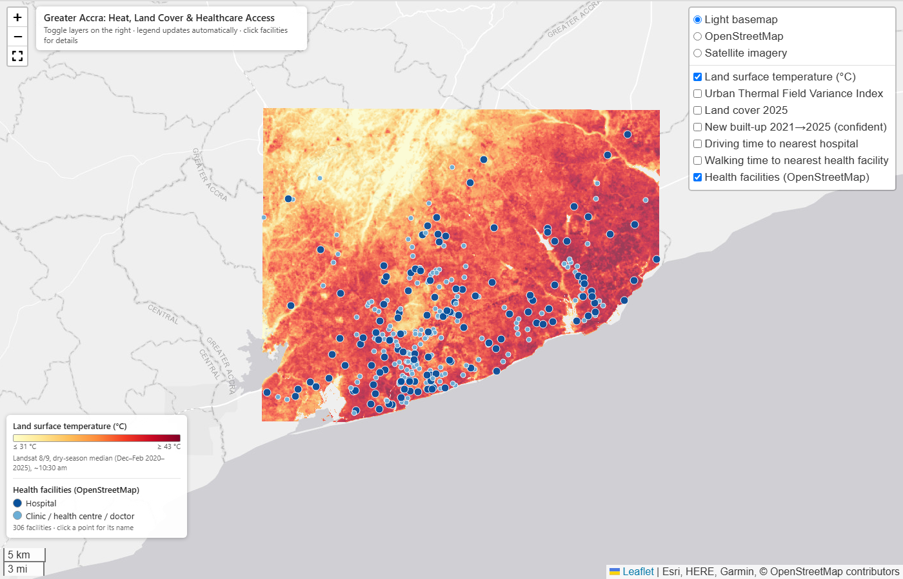

# Interactive Web Map: Greater Accra Heat, Land Cover & Healthcare Access

<!--**Live map → https://rashidtobrazune.github.io/accra-web-map/**-->

A single interactive Leaflet map that brings together the results of three Accra analysis projects. You can
switch layers on and off, change the basemap, zoom down to street level, and click health facilities to see
their names.



## Layers

| Layer | From project | What it shows |
|---|---|---|
| Land surface temperature | [urban-heat-island-accra](https://github.com/RashidTobrazune/urban-heat-island-accra) | Dry-season median LST from Landsat 8/9 (31–43 °C) |
| Urban Thermal Field Variance Index | urban-heat-island-accra | Ecological evaluation of surface heat, from *Excellent* to *Worst* |
| Land cover 2025 | [land-cover-classification-accra](https://github.com/RashidTobrazune/land-cover-classification-accra) | Sentinel-2 Random Forest map, 7 classes, 84% accuracy |
| New built-up 2021→2025 | land-cover-classification-accra | Vegetation converted to built-up (≥ 70% confidence in both years) |
| Driving time to nearest hospital | [healthcare-access-accra](https://github.com/RashidTobrazune/healthcare-access-accra) | Network travel time bands: 0–15, 15–30, 30–60, > 60 min |
| Walking time to nearest health facility | healthcare-access-accra | Walking time bands at 4.5 km/h |
| Health facilities | healthcare-access-accra | 306 OpenStreetMap hospitals and clinics; click for the name |

There are three basemaps: Esri Light Gray, OpenStreetMap and Esri World Imagery (satellite).

**Things to try:**
- Turn on *Walking time* and *Land surface temperature* together to find neighbourhoods that are both hot
  and far from care.
- Switch to *Satellite imagery* and *New built-up* to see where the city is expanding.

## How it works

1. **Reproject.** Each GeoTIFF from the analysis projects is reprojected to Web Mercator (EPSG:3857), the
   projection web maps use, so it lines up exactly with the basemap tiles.
2. **Colour.** Each layer is coloured according to `config.yaml`:
   - continuous colour ramp: temperature
   - categorical classes: land cover, UTFVI, urban change
   - travel-time bands: driving and walking times

   No-data pixels become transparent.
3. **Assemble.** [folium](https://python-visualization.github.io/folium/) combines the layers into a Leaflet
   map. A small piece of JavaScript keeps the legend in step with whichever layers are switched on.
4. **Package.** Everything is embedded in **one self-contained HTML file** (`docs/index.html`, about 3.5 MB),
   which GitHub Pages serves as a website.

## Rebuild it

The map reads the `outputs/` folders of the three analysis projects, so clone those next to this repo and run
them first. Your folders should look like this:

```
├── urban-heat-island-accra/outputs/...
├── land-cover-classification-accra/outputs/...
├── healthcare-access-accra/outputs/...
└── accra-web-map/            <- this repo
```

```bash
cd accra-web-map
python -m venv .venv
# Windows: .venv\Scripts\activate    macOS/Linux: source .venv/bin/activate
pip install -e ".[dev]"
build-webmap --config config.yaml   # writes docs/index.html in a few seconds
pytest                              # unit tests
```

Layers, colours, labels, opacity and the starting view are all set in [`config.yaml`](config.yaml).
To add a layer, add an entry pointing to any GeoTIFF.

## Publish with GitHub Pages

Go to **Settings → Pages**. Under *Build and deployment*, set *Source* to **Deploy from a branch**, choose
**main** and the **/docs** folder, then click **Save**. The map goes live at
`https://<username>.github.io/accra-web-map/` within a minute or two.

## Project structure

```
├── config.yaml              # Layers, colours, title, view
├── src/accra_webmap/
│   ├── rasters.py           # Reprojection, colourisation, legend HTML (pure functions)
│   └── build.py             # folium/Leaflet map assembly → docs/index.html
├── tests/                   # pytest unit tests
└── docs/
    ├── index.html           # The web map (served by GitHub Pages)
    └── images/screenshot.png
```

## Credits

- Basemaps: Esri (Light Gray Canvas, World Imagery), © OpenStreetMap contributors.
- Data: Landsat 8/9 (USGS), Sentinel-2 (ESA/Copernicus), ESA WorldCover, WorldPop, OpenStreetMap. See each
  analysis project for full credits.
- Built with folium, Leaflet, rasterio and matplotlib.

## License

MIT. See [LICENSE](LICENSE).
